<p align="center"></p>

# Oratio

An mobile LLM chat client for any OpenAI-compatible API, written in Rust/

| Chat | Drawer | Settings |
| --- | --- | --- |
| 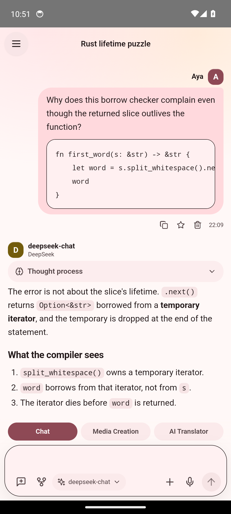 | 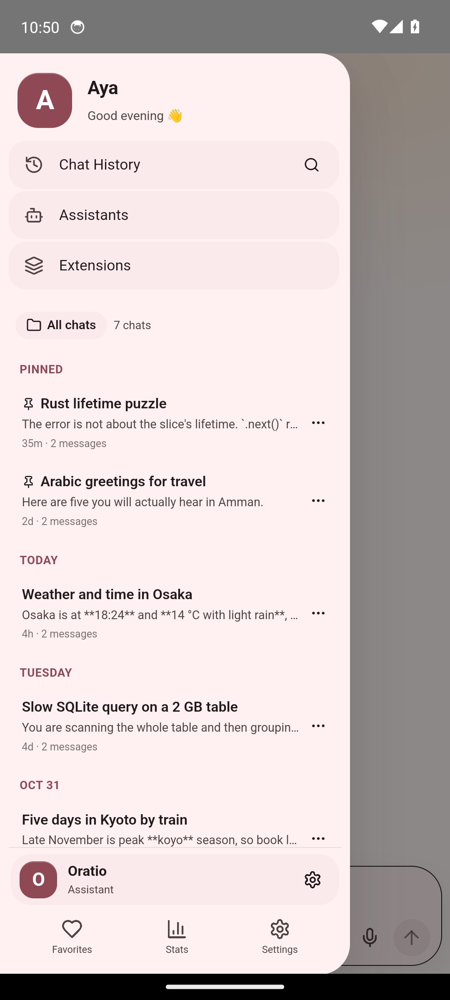 | 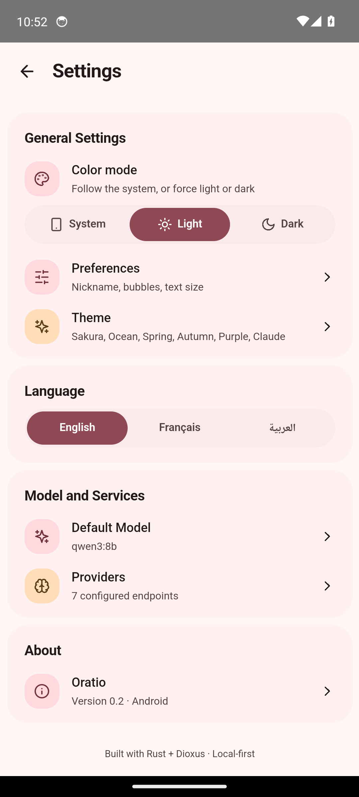 |

| Statistics | Media creation | Dark theme |
| --- | --- | --- |
| 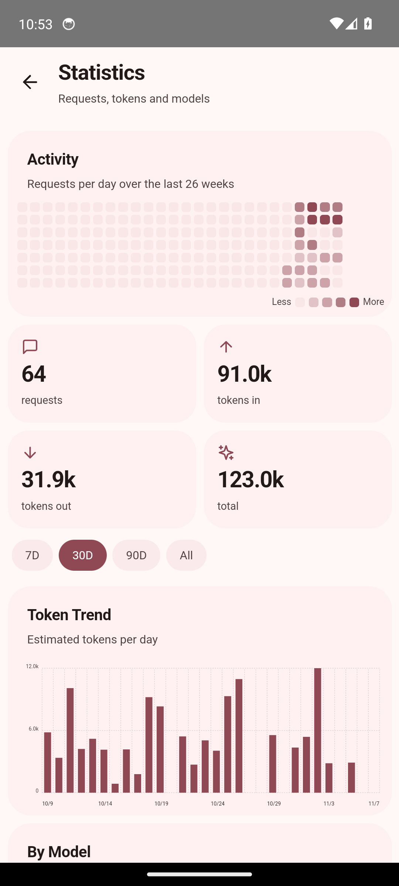 | 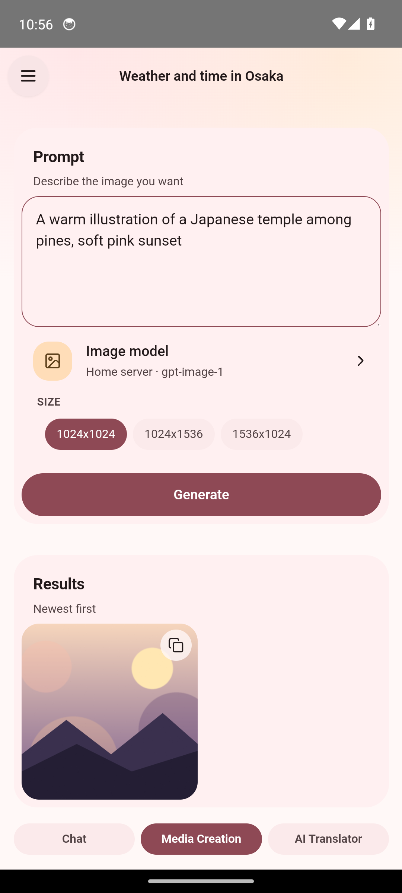 | 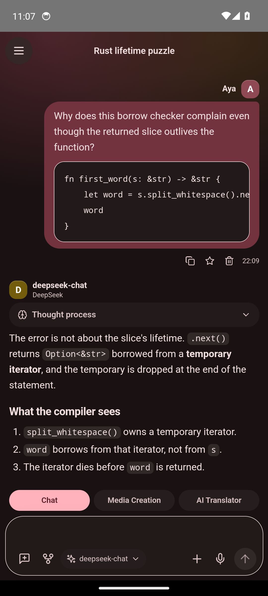 |

| Assistant editor | Composer tools | MCP tool call |
| --- | --- | --- |
| 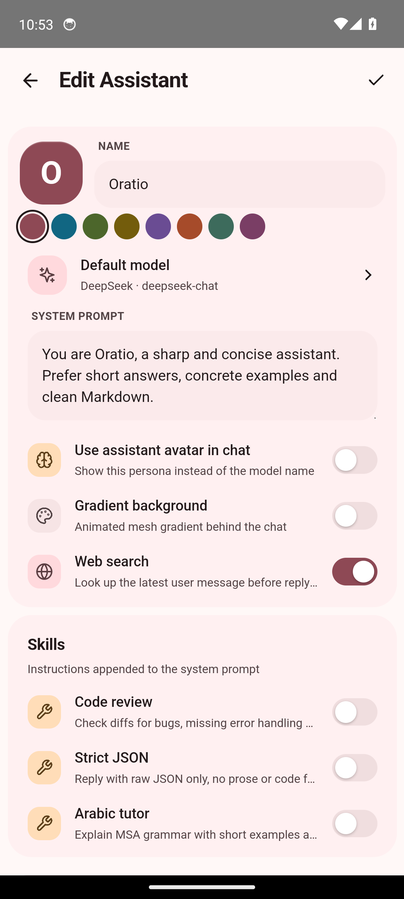 | 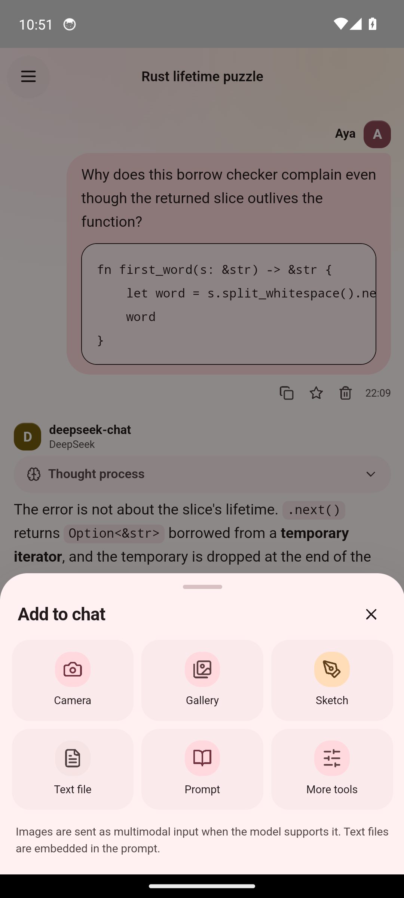 | 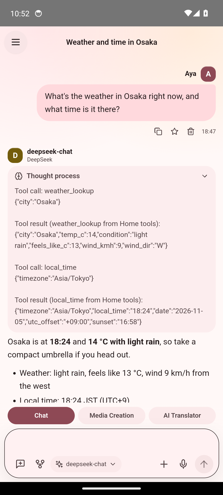 |

| AI Translator | Purple theme | Extensions |
| --- | --- | --- |
| 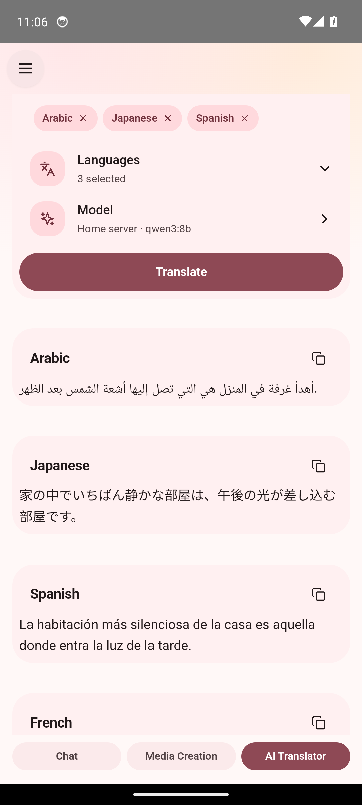 | 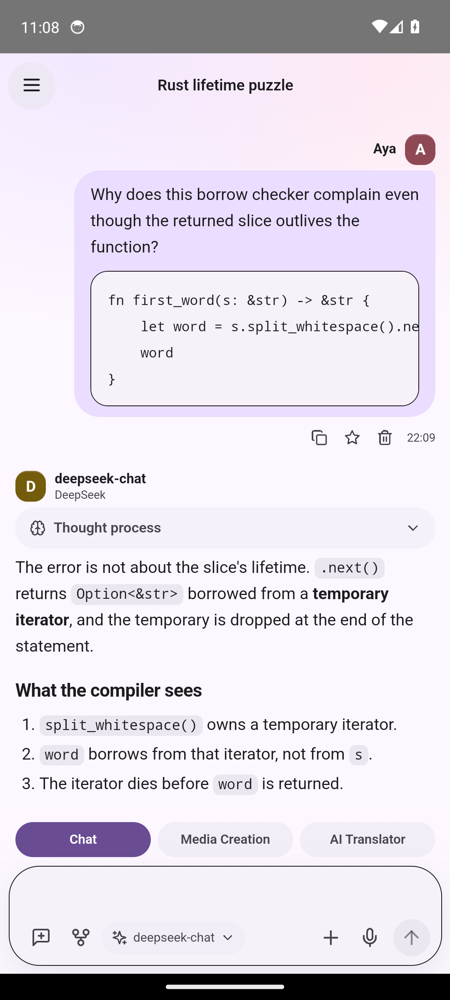 | 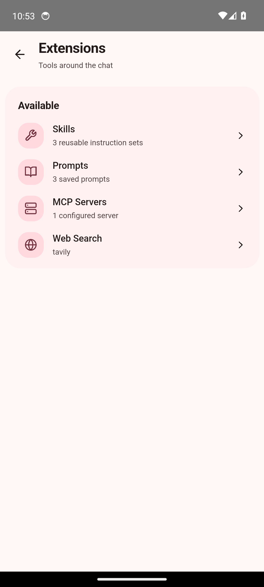 |

## What it does

- **Providers and chat**: any OpenAI-compatible endpoint, with model fetch and a
  connection test; streaming Markdown replies, collapsible reasoning, stop and
  retry, message actions, history search and favorites.
- **Assistants (Agents)**: named personas with avatar color, system prompt, default model,
  skills and web-search toggle, switched from the drawer or chat menu.
- **Composer**: camera, gallery, sketch pad and text-file attachments; local
  Whisper dictation that works offline.
- **Tools**: Tavily/Exa/Brave web search, Markdown skills, a saved prompt library,
  streamable-HTTP MCP tool calling, and context compression.
- **Extra screens**: image generation, multi-language AI translation, and
  statistics charts.
- **Privacy-first**: local SQLite, no cloud and no telemetry.

## Install

**[Download Oratio 0.1.0 (APK)](https://github.com/O-ELMA/oratio/releases/download/0.1.0/oratio-0.1.0.apk)** for Android. The phone will warn you because it is installed by hand, not from a store. Allow installs from your browser when it asks.

## Use

1. Open the drawer, then **Settings → Providers → ＋**.
2. Enter a name and the base URL, for example:
   - OpenAI: `api.openai.com/v1`
   - DeepSeek: `api.deepseek.com/v1`
   - Ollama / LM Studio: `192.168.1.10:11434/v1`
   - any relay that speaks the OpenAI `chat/completions` protocol
3. Enter the API key (empty is fine for local servers), tap **Fetch models** or type one model ID per line, then save.
4. Start a chat, pick a model, and send a message.

The base URL is the part before `/chat/completions`. A trailing slash or a URL
already ending in `/chat/completions` or `/models` is normalized.

## Data and privacy

- Everything is stored in an SQLite database in the app's private directory: `/data/user/0/me.yoaxis.rustchat/files/rustchat.db` (debug builds can reach it with `adb shell run-as me.yoaxis.rustchat`).
- On first start, an old `state.json` from the earlier build is imported into SQLite and renamed `state.json.imported`.
- API keys are stored in that database as plain text. Uninstalling the app removes it.
- Requests go directly from the phone to the provider. There is no Oratio server and no telemetry.
- Dictation audio never leaves the phone. The Whisper model (~181 MB) is downloaded once from Hugging Face and stored in the app's private directory.
- Cleartext HTTP is enabled so local OpenAI-compatible servers can be used. HTTPS providers use the bundled Mozilla root store.

## Build

Requirements:

- Rust with the Android targets
- Android SDK 34, NDK 27, JDK 17
- Dioxus CLI 0.7.10 (`cargo install dioxus-cli` or the official installer)

```sh
rustup target add aarch64-linux-android x86_64-linux-android
export ANDROID_HOME=/path/to/android-sdk
export ANDROID_NDK_HOME=/path/to/android-ndk

bash scripts/build-android.sh release aarch64-linux-android
```

The script runs `dx build`, copies the Oratio launcher icon into the generated
Android project (`dx` 0.7.10 always writes its own default icon), repacks the APK
with Gradle, and writes `dist/oratio-aarch64-release.apk`.

Plain `dx build --platform android --target aarch64-linux-android --release`
also works, but it keeps the default Dioxus icon and does not set up the NDK
environment that whisper.cpp needs. Use the script when voice input is included.

## Layout

```
src/app.rs          global state, navigation, generation, SQLite persistence calls
src/speech.rs       Whisper model download, AAudio capture, local transcription
src/ui/chat.rs      chat screen, composer, message actions, compression, attachments
src/ui/drawer.rs    drawer, profile, conversation list, assistant picker entry
src/ui/assistants.rs assistants list/editor/sheet
src/ui/pages.rs     history, search, favorites, extensions hub
src/ui/translator.rs AI translator panel and searchable language picker
src/ui/settings.rs  settings, theme presets, preferences, default model, about
src/ui/providers.rs provider list/form, model fetch, connection test
src/ui/stats.rs     heatmap, dioxus-charts bar/pie charts, rankings
src/ui/extensions.rs skills, prompts, web-search settings, MCP management
src/ui/media.rs     image generation
src/store.rs        data model, normalization, SQLite schema/queries
src/api.rs          OpenAI chat/SSE/models/images, web search, MCP client
assets/             CSS and icon source
android/            custom manifest + launcher icon resources
scripts/            build-android.sh
```

## Known limits

- MCP is streamable HTTP only. stdio servers are not supported, and tool calls
  run sequentially rather than in parallel.
- Images must be accepted by the selected model as OpenAI `image_url` parts.
  PDFs, Word files and audio are not extracted.
- No workspace, terminal, TTS, web server, media sessions or cloud sync.
- Dictation uses Whisper `small`: expect a 181 MB first-launch download,
  ~850 MB RAM while transcribing, and several seconds per sentence on slower
  phones.
- The UI runs in an Android WebView through Dioxus mobile.
- Debug-signed APK: fine for sideloading, not for distribution.
